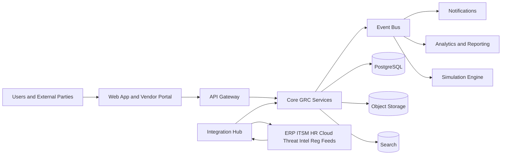

# GRC Platform: Software Requirements Specification (SRS)

**Product working name:** Aegis GRC (placeholder)
**Document version:** 1.0 (Draft for engineering review)
**Date:** 2026-11-17
**Audience:** Engineering, Product, Security, QA, DevOps, Design

---

## Table of Contents
1. Introduction
2. Product Overview and Personas
3. System Architecture
4. Cross-Cutting Platform Requirements
5. Functional Requirements by Module
   - 5.1 Enterprise Risk Management (ERM)
   - 5.2 Compliance and Regulatory Change Management
   - 5.3 Policy and Governance Management
   - 5.4 Internal Audit Management
   - 5.5 Third-Party Risk Management (TPRM)
   - 5.6 Business Continuity and Operational Resilience
   - 5.7 Reporting, Dashboards and Analytics
   - 5.8 Integrations Framework
   - 5.9 Identity, RBAC and Administration
6. Data Model
7. API Specification
8. Non-Functional Requirements
9. Security and Compliance of the Platform Itself
10. Release Phasing (MVP to GA)
11. Testing and Quality Strategy
12. Open Questions and Assumptions
13. Appendices

Requirement IDs use the form `MOD-NNN`. Priority: **P0** = MVP-critical, **P1** = required for GA, **P2** = post-GA.
Keywords MUST / SHOULD / MAY follow RFC 2119.

---

## 1. Introduction

### 1.1 Purpose
Define the functional and non-functional requirements for a multi-tenant SaaS Governance, Risk and Compliance (GRC) platform that unifies enterprise risk, compliance, policy, internal audit, third-party risk and business continuity in one system of record, with shared data, workflow and reporting.

### 1.2 Scope
In scope: the seven capability areas in the product brief. Out of scope for v1: a native mobile app (responsive web only), a native ticketing system (integrate with ITSM instead), LMS content authoring (integrate or embed), and legal e-discovery.

### 1.3 Product Principles
1. **One data model, many lenses.** Risks, controls, assets, vendors, policies, processes and issues are first-class shared objects linked to each other. Modules are views and workflows on that graph, not silos.
2. **Test once, comply many.** A control is defined once and mapped to many framework requirements.
3. **Continuous over periodic.** Prefer automated evidence and monitoring over manual snapshots.
4. **Configurable without code.** Fields, workflows, scoring, forms and dashboards are tenant-configurable.
5. **Auditable by default.** Every change is attributable, timestamped and immutable in the audit trail.
6. **Least privilege.** Row-, object- and field-level access control is enforced server-side.

---

## 2. Product Overview and Personas

| Persona | Primary goals | Key modules |
|---|---|---|
| Chief Risk Officer / Head of ERM | Enterprise risk posture, appetite, board reporting | ERM, Reporting |
| Compliance Officer | Framework coverage, regulatory change, control testing | Compliance, Policy |
| Control / Risk Owner (business) | Complete assigned tasks, attest, remediate | All (task inbox) |
| Internal Audit Director / Auditor | Plan, execute, report audits; track issues | Audit |
| CISO / IT Risk Manager | Cyber risk quantification, CCM, vendor security | ERM, Compliance, TPRM |
| Procurement / Vendor Manager | Onboard and monitor suppliers | TPRM |
| BCM / Resilience Lead | BIA, plans, exercises, incident activation | BCM |
| Legal / Policy Owner | Draft, review, publish policies | Policy |
| Executive / Board member | Read-only dashboards and reports | Reporting |
| Employee | Read policies, attest, complete training, request exceptions | Policy |
| External Vendor user | Complete questionnaires, upload evidence | TPRM portal |
| External Auditor | Time-boxed read access to evidence and workpapers | Audit |
| Tenant Administrator | Configure platform, users, integrations | Admin |
| Platform Operator (vendor staff) | Operate the SaaS, support tenants | Internal ops console |

---

## 3. System Architecture

### 3.1 Architectural Style
- Cloud-native, multi-tenant SaaS (AWS recommended; stay cloud-portable where cost-effective).
- Modular monolith for the core GRC domain at launch; extract services where scaling or isolation demands (integration workers, CCM ingestion, reporting/analytics, simulation engine, notifications). Module boundaries MUST be enforced in code from day one.
- API-first: the web UI consumes the same public APIs offered to customers.
- Event-driven backbone for cross-module reactions (e.g., a failed control test creates an issue and updates linked risk scores).

### 3.2 Recommended Reference Stack (final choices at architecture review)
| Layer | Recommendation | Notes |
|---|---|---|
| Frontend | TypeScript, React, accessible component library, TanStack Query | Charts: ECharts or similar |
| API | REST (OpenAPI 3.1) primary; GraphQL read gateway MAY be added for dashboards | Versioned `/v1` |
| Backend | TypeScript (NestJS) or Java/Kotlin (Spring Boot); Python for simulation/analytics workers | Choose one primary language |
| Primary DB | PostgreSQL with row-level security | JSONB for custom fields |
| Search | OpenSearch/Elasticsearch | Full text across objects |
| Cache / queue | Redis; Kafka or SQS/SNS; Temporal or equivalent for durable workflows | |
| Object storage | S3-compatible, per-tenant prefixes and KMS keys | Evidence, documents |
| Time series | TimescaleDB or ClickHouse | KRI and CCM telemetry |
| Analytics | ClickHouse or columnar warehouse; semantic metrics layer | Dashboards, board reports |
| Identity | OIDC/SAML SSO, SCIM 2.0 | |
| Infra | Kubernetes, Terraform, GitOps, isolated environments | |
| Observability | OpenTelemetry, centralized logs/metrics/traces | |

### 3.3 Multi-Tenancy
- **MT-001 (P0)** Tenant data MUST be logically isolated: `tenant_id` on every table plus Postgres row-level security as defense in depth.
- **MT-002 (P1)** Per-tenant encryption keys (customer-managed KMS keys for enterprise tier).
- **MT-003 (P1)** Data residency by region (US, EU, UK, APAC minimum); data and backups remain in region.
- **MT-004 (P2)** Dedicated single-tenant deployment option.
- **MT-005 (P0)** Noisy-neighbor protection: per-tenant rate limits, job quotas, query timeouts.

### 3.4 Core Platform Services
Workflow engine, rules engine, notification service, document service, search service, audit-log service, integration hub, scheduler, reporting service, custom-field/metadata service, localization service, entitlement/licensing service.

### 3.5 Logical Context

---

## 4. Cross-Cutting Platform Requirements

### 4.1 Common Object Capabilities
Every first-class object (risk, control, policy, issue, audit, vendor, process, etc.) MUST support:
- **CC-001 (P0)** Immutable unique ID plus human-readable reference code (e.g., `RSK-000123`) with configurable prefix.
- **CC-002 (P0)** Owner, delegate, business unit, status, created/updated metadata.
- **CC-003 (P0)** Tenant-defined custom fields (text, number, date, enum, multi-select, user, reference, formula, file) with validation and conditional visibility.
- **CC-004 (P0)** Typed relationships to any other object (risk to control, control to requirement, vendor to process).
- **CC-005 (P0)** Comments with @mentions, attachments, activity feed.
- **CC-006 (P0)** Field-level change history, viewable and exportable.
- **CC-007 (P0)** Tags, saved filters, bulk edit, CSV/XLSX import and export with validation preview.
- **CC-008 (P1)** Soft delete with retention policy; hard delete only via purge that respects legal hold.
- **CC-009 (P1)** Legal-hold flag blocking deletion and retention purge.
- **CC-010 (P0)** Org-hierarchy awareness: objects attach to nodes in a configurable hierarchy (legal entity, region, business unit, department) with roll-up.

### 4.2 Workflow Engine
- **WF-001 (P0)** Visual designer for state machines: states, transitions, guards, required fields per state, SLAs, roles per transition.
- **WF-002 (P0)** Task types: approval (single, sequential, parallel, quorum), review, attestation, data request.
- **WF-003 (P0)** Delegation, out-of-office reassignment, escalation after SLA breach.
- **WF-004 (P1)** Conditional routing by field values (e.g., score above threshold requires CRO approval).
- **WF-005 (P1)** Versioned workflow definitions; in-flight items remain on their starting version unless migrated.
- **WF-006 (P0)** Every transition logged with actor, time, comment.
- **WF-007 (P1)** E-signature (re-authentication plus signed manifest, suitable for regulated-record use).

### 4.3 Notifications
- **NT-001 (P0)** In-app and email; **P1** Microsoft Teams, Slack, SMS, webhook.
- **NT-002 (P0)** User preferences and digests; tenant templates with variables and localization.
- **NT-003 (P0)** Configurable reminder schedules (e.g., T-14, T-7, T-1, overdue, repeat) per object type.
- **NT-004 (P1)** Email reply-to-action for simple approvals (signed, expiring tokens).

### 4.4 Search and Navigation
- **SR-001 (P0)** Global type-ahead search across accessible objects, permission-aware.
- **SR-002 (P1)** Saved/shared views and boolean query builder.
- **SR-003 (P1)** Relationship graph explorer (e.g., from a business process to its risks, controls, vendors, policies, issues).

### 4.5 Document and Evidence Management
- **DM-001 (P0)** Versioned storage with SHA-256 checksum at upload; immutability option for evidence.
- **DM-002 (P0)** Antivirus scan on upload; file-type allow-list; configurable size limits.
- **DM-003 (P1)** In-browser preview for PDF, Office, images, text.
- **DM-004 (P1)** Redaction and watermarking on export.
- **DM-005 (P1)** Retention schedules per evidence type with automated purge honoring legal holds.
- **DM-006 (P0)** One evidence item can link to many controls, tests and audits without duplication.

### 4.6 Localization and Accessibility
- **L10N-001 (P1)** Localized UI and notifications; launch with English plus French, German, Spanish, Japanese. Locale-aware dates, numbers, currencies, time zones.
- **A11Y-001 (P0)** WCAG 2.2 AA for all end-user screens and the vendor portal.
- **A11Y-002 (P1)** Chart data available as accessible tables.

### 4.7 Configuration
- **CFG-001 (P0)** Tenant-level taxonomies (risk categories, control types, severity scales, vendor tiers, etc.).
- **CFG-002 (P1)** Sandbox tenant and configuration promotion (export/import packages between environments).
- **CFG-003 (P0)** All configuration changes audited.

---

## 5. Functional Requirements by Module

### 5.1 Enterprise Risk Management (ERM)

#### 5.1.1 Centralized Risk Registers
- **ERM-001 (P0)** One risk repository supporting multiple registers (enterprise, operational, financial, cyber/IT, strategic, compliance, project, third-party, ESG, custom) on one object model, with per-register templates (fields, scales, workflow).
- **ERM-002 (P0)** Risk fields: title, description, category/sub-category, cause, event, consequence, owner, business unit(s), affected assets/processes/vendors, inherent score, residual score, target score, appetite link, status, treatment strategy (mitigate, accept, transfer, avoid), review date, source (assessment, audit, incident, KRI breach).
- **ERM-003 (P0)** Hierarchical roll-up from BU/entity to enterprise with configurable aggregation (max, average, weighted, sum of financial exposure).
- **ERM-004 (P0)** Lifecycle workflow: identified, assessed, treated, monitored, closed/archived; approval gates for acceptance above appetite.
- **ERM-005 (P0)** Assessment campaigns (RCSA): schedule, assign, collect via forms, roll up, track completion.
- **ERM-006 (P1)** Risk library with starter taxonomy and risks aligned to COSO ERM, ISO 31000, NIST CSF/RMF, ISO 27005; importable and customizable.
- **ERM-007 (P1)** Duplicate detection on creation; merge workflow.
- **ERM-008 (P1)** Bow-tie view (causes, preventive controls, event, mitigating controls, consequences).
- **ERM-009 (P1)** Treatment plans with tasks, owners, budgets, due dates, projected residual score.
- **ERM-010 (P1)** Risk appetite and tolerance statements per category/unit with automatic breach flags and escalation.
- **ERM-011 (P1)** Emerging-risk intake from employees with triage queue.
- **ERM-012 (P2)** Link risks to strategic objectives/OKRs.

#### 5.1.2 Risk Scoring and Quantification
- **ERM-020 (P0)** Configurable qualitative scales: likelihood and impact from 3x3 up to 10x10, custom labels and descriptors per impact dimension (financial, operational, reputational, legal, safety), aggregation by max or weighted.
- **ERM-021 (P0)** Configurable heat maps: grid size, color bands, formula (multiplicative, lookup matrix, custom), tolerance zones; separate maps for inherent, residual, target; click-through to risks; filter by register, BU, category, owner, date.
- **ERM-022 (P0)** Residual score derived from inherent score and linked control effectiveness via configurable formula; manual override requires justification.
- **ERM-023 (P0)** KRIs: metric, unit, source (manual, CSV, API, integration), frequency, thresholds (green/amber/red, directional), owner, linked risks; time-series storage, trend charts, breach alerts, escalation, optional flagging or adjustment of linked risk scores.
- **ERM-024 (P1)** KRI library of recommended indicators per category.
- **ERM-025 (P1)** FAIR-aligned quantitative analysis:
  - Per scenario inputs: Threat Event Frequency, Vulnerability (or Contact Frequency x Probability of Action), Loss Event Frequency, Primary Loss Magnitude, Secondary Loss Magnitude (with secondary loss event frequency), entered as calibrated ranges (min / most likely / max plus confidence) using PERT or lognormal distributions.
  - Monte Carlo simulation (default 10,000 iterations; up to 1M asynchronously) producing Annualized Loss Expectancy, loss exceedance curve, percentiles (P10, P50, P90, P95), and probability of exceeding a threshold.
  - Reproducible runs: store seed, input snapshot and model version per run.
  - Compare treatment options (control cost vs. reduction in expected loss, ROI).
  - Portfolio aggregation (independence and simple correlation at P1; copulas P2).
- **ERM-026 (P1)** Estimation calibration guidance and storage of SME rationale with each estimate.
- **ERM-027 (P1)** Mapping between qualitative scores and dollar exposure bands, so both views reconcile.
- **ERM-028 (P0)** Score history retained for trend and risk-movement reports.

#### 5.1.3 Scenario and Sensitivity Analysis
- **ERM-040 (P1)** Scenario library (ransomware, cloud outage, key-vendor failure, regulatory fine, FX or interest-rate shock, pandemic, supply disruption, data breach) plus custom scenarios with parameters, affected objects and assumptions.
- **ERM-041 (P1)** Apply parameter changes (frequency multipliers, loss shifts, control failures, vendor unavailability) across linked risks and compute effects on scores, expected loss, KRIs and, where connected, process downtime.
- **ERM-042 (P1)** Sensitivity analysis: tornado charts, one-way and two-way sweeps.
- **ERM-043 (P1)** Baseline vs. scenario side-by-side; save, version, share, export.
- **ERM-044 (P2)** Stress tests with imported macroeconomic variables; reverse stress tests.
- **ERM-045 (P1)** Cascading dependency analysis over the relationship graph (e.g., cloud region outage affects applications, processes, vendors, risks).
- **ERM-046 (P1)** Simulations run asynchronously with progress, cancel, and per-plan compute quotas.

### 5.2 Compliance and Regulatory Change Management

#### 5.2.1 Regulatory Horizon Scanning
- **REG-001 (P1)** Ingest regulatory content from licensed provider APIs (e.g., Thomson Reuters, Wolters Kluwer, Compliance.ai, Regology; provider TBD), government feeds (EUR-Lex, Federal Register, UK legislation, regulator sites) and manual entry.
- **REG-002 (P1)** Normalized Regulatory Item: title, jurisdiction, regulator, publication and effective dates, status (proposed, final, in force, repealed), industries, topics, source URL, summary, full text, attachments.
- **REG-003 (P1)** Subscription profiles (jurisdictions, industries, topics, regulators, keywords) and routing rules to owners.
- **REG-004 (P1)** AI-assisted classification and summarization with source citation; humans MUST confirm relevance before obligations are created; machine output is labeled.
- **REG-005 (P1)** Impact assessment workflow: triage, assess, assign tasks, update controls/policies/processes, sign off, track to closure.
- **REG-006 (P1)** Obligation register: citation-level obligations with owners and control mappings.
- **REG-007 (P1)** Deadline calendar and change timeline with alerts.
- **REG-008 (P2)** Redline comparison between regulation versions.

#### 5.2.2 Multi-Framework Mapping (Unified Control Framework)
- **FW-001 (P0)** Framework library covering at least: ISO/IEC 27001:2022 and 27002, SOC 2 (TSC), NIST CSF 2.0, NIST SP 800-53 Rev.5, NIST 800-171, CIS Controls v8, PCI DSS v4.0, HIPAA, GDPR, UK GDPR, CCPA/CPRA, SOX (ICFR/COSO 2013), COBIT 2019, ISO 22301, ISO 31000, ISO 27701, DORA, NIS2, EU AI Act, ISO 42001, FedRAMP, CMMC 2.0, NYDFS 500. Licensed content (e.g., ISO, PCI) MUST be handled per license; legal review is P0.
- **FW-002 (P0)** Custom frameworks: tenants import or author internal standards and contractual requirements with hierarchical requirements.
- **FW-003 (P0)** Unified control library: one control record mapped to N requirements across M frameworks with mapping type (full, partial, supports) and rationale.
- **FW-004 (P0)** Test once, reuse: one test result and evidence set satisfies all mapped requirements; per-framework views show status without duplicate work.
- **FW-005 (P0)** Gap analysis per framework: unmapped requirements, untested controls, failing controls, compliance percentage by scope.
- **FW-006 (P1)** Crosswalk suggestions from curated crosswalks (e.g., NIST OLIR, SCF) and AI similarity; human approval required.
- **FW-007 (P0)** Scoping: which frameworks apply to which entities/BUs/systems; versioned applicability statements (e.g., ISO 27001 SoA).
- **FW-008 (P1)** Framework version management with diffs and mapping migration.
- **FW-009 (P1)** Certification tracking (audit windows, auditors, certificates, expiry alerts) and exportable auditor packs.
- **FW-010 (P0)** Control attributes: type (preventive, detective, corrective), nature (manual, automated), frequency, owner, tester, key-control flag, assertions, related processes and systems.
- **FW-011 (P0)** Control testing: test plans, sample selection (random, systematic, risk-based, population upload), procedures, results (effective, deficient, not tested), reviewer sign-off, retests, deficiency classification (deficiency, significant deficiency, material weakness).
- **FW-012 (P1)** Control self-assessments and owner attestation campaigns.
- **FW-013 (P1)** SOX: risk and control matrices, segregation-of-duties rule library with ERP role import, quarterly sub-certifications, deficiency aggregation.
- **FW-014 (P1)** Privacy: records of processing, DPIA/PIA templates, breach register with jurisdictional notification deadlines; full DSAR automation P2.

#### 5.2.3 Continuous Control Monitoring (CCM)
- **CCM-001 (P1)** Connectors (see 5.8) pull configuration, state and log data on schedule or via streaming/webhooks.
- **CCM-002 (P1)** Declarative monitoring rules over normalized evidence (e.g., MFA on all privileged users, no public storage buckets, endpoint disk encryption, leavers deprovisioned within 24h, critical patches within 14 days). Policy-as-code DSL in JSON/YAML; OPA/Rego or CEL for advanced rules.
- **CCM-003 (P1)** Prebuilt rule library per connector, mapped to controls and framework requirements.
- **CCM-004 (P1)** Each run yields an immutable result with evidence snapshot (timestamp, source, query, raw response hash) usable as audit evidence.
- **CCM-005 (P1)** Failures auto-create issues (configurable), update control status, optionally raise linked risk/KRI; deduplicate repeats; auto-resolve on pass with retest evidence.
- **CCM-006 (P1)** Scope by tags and inclusions; approved exceptions (5.3.3) suppress failures until expiry.
- **CCM-007 (P1)** Dashboard: pass rate by control, framework, system; drift over time; mean time to remediate.
- **CCM-008 (P2)** Business-process monitoring on ERP data (duplicate payments, SoD violations, after-hours postings, three-way-match anomalies) via SAP/Oracle/NetSuite/Workday.
- **CCM-009 (P1)** Connectors use least-privilege read-only credentials held in a secrets vault; prefer customer-assumed roles (AWS cross-account role with external ID, Azure app registration) over static keys.
- **CCM-010 (P1)** Scale to tens of thousands of resources per tenant with hourly checks (P1); near real-time event-driven (P2).

### 5.3 Policy and Governance Management

#### 5.3.1 End-to-End Policy Lifecycle
- **POL-001 (P0)** Hierarchy: policy, standard, procedure, guideline, work instruction with parent/child links, mapped to controls and requirements.
- **POL-002 (P0)** Authoring: rich-text editor, templates, collaborative editing, tracked changes, comments; import DOCX/PDF; branded PDF/DOCX export.
- **POL-003 (P0)** States: draft, legal review, business review, pending approval, approved, published, under revision, expired/retired, archived; workflow configurable per policy type.
- **POL-004 (P0)** Major/minor versions, diff, restore, immutable published versions, effective dates, supersession links.
- **POL-005 (P0)** Scheduled periodic review (annual default) with reminders and overdue flags.
- **POL-006 (P1)** Scheduled retirement with workflow, notices and archival.
- **POL-007 (P1)** Employee-facing policy portal: search, audience-based visibility, language variants, "what changed" summaries.
- **POL-008 (P1)** Traceability from regulation to policy to control; flag orphaned policies.
- **POL-009 (P2)** AI-assisted drafting and gap-checking against frameworks; human review required; tenant data MUST NOT train shared models.
- **POL-010 (P1)** Legal-entity or country variants (global base with local addenda).

#### 5.3.2 Employee Attestation and Training
- **ATT-001 (P0)** Campaigns: select policy versions, audience (HR attribute, group, role, entity, location, or uploaded list), due date, reminders, manager escalation, grace periods.
- **ATT-002 (P0)** Capture acknowledgment with timestamp, identity, policy version, IP/device metadata; optional quiz gate with pass mark; optional e-signature.
- **ATT-003 (P0)** Audience sourcing from HR/IdP (Workday, SuccessFactors, BambooHR, Entra ID, Okta, Google Workspace) with joiner/mover/leaver handling.
- **ATT-004 (P1)** Training tracking via LMS integration (Cornerstone, Workday Learning, KnowBe4, Docebo, SuccessFactors Learning) using API, SCORM, xAPI or LTI; or lightweight built-in quizzes.
- **ATT-005 (P0)** Completion dashboards by policy, BU, manager; overdue lists; auditor-ready exports.
- **ATT-006 (P1)** Automatic re-attestation on material version publish.
- **ATT-007 (P1)** Lightweight SSO attestation experience for employees without full licenses.

#### 5.3.3 Exception Management
- **EXC-001 (P0)** Request form: exception target (policy, standard, control, requirement), justification, scope, risk assessment, compensating controls, duration, requester, owner.
- **EXC-002 (P0)** Configurable approvals (by risk level, policy owner, CISO, legal), parallel and sequential, with SLA timers.
- **EXC-003 (P0)** Time-boxed validity with maximum duration per policy type, pre-expiry reminders, auto-expiry with escalation, renewal workflow.
- **EXC-004 (P0)** Exception register with filters, expiring-soon view, reports.
- **EXC-005 (P1)** Link to risks (acceptance), suppress CCM failures for in-scope resources, surface on audit and vendor records.
- **EXC-006 (P1)** Periodic review of active exceptions; aggregate "exception debt" metric.

### 5.4 Internal Audit Management

#### 5.4.1 Risk-Based Audit Planning
- **AUD-001 (P0)** Audit universe of auditable entities (processes, departments, systems, vendors, legal entities, projects) linked to the shared graph, with size, complexity, last-audit date, owner.
- **AUD-002 (P1)** Risk-based prioritization from live data (linked risk scores, KRI breaches, open issues, control failures, incidents, regulatory change, time since last audit, management requests), with configurable weights and a transparent score breakdown; ranked output.
- **AUD-003 (P0)** Annual plan with audits, quarters, hour budgets, skills, approvals; rolling re-plan with change log.
- **AUD-004 (P1)** Resource management: auditor skills, certifications, availability, cost rate, capacity planning, timesheets.
- **AUD-005 (P1)** Coverage reporting: percent of high-risk universe audited, plan vs. actual, assurance map across lines of defense.
- **AUD-006 (P1)** Aligned to IIA Global Internal Audit Standards (2024); optional ISO 19011 and ISACA ITAF templates.

#### 5.4.2 Automated Workpapers and Evidence
- **AUD-020 (P0)** Engagement workspace: scope memo, objectives, RCM from the shared control library, work program, schedule, team, status.
- **AUD-021 (P0)** Workpaper templates and work-program library; each step has procedure, sample, results, conclusion, evidence references, preparer and reviewer sign-offs, review-note workflow.
- **AUD-022 (P1)** Automated evidence pull from connectors (CCM results, configs, user lists, tickets, logs) with provenance; PBC request lists with assignments, due dates, reminders; client upload portal.
- **AUD-023 (P1)** Sampling: random, stratified, monetary-unit, attribute; sample-size calculators; population upload with completeness checks.
- **AUD-024 (P0)** Findings: condition, criteria, cause, effect, recommendation, rating; linked to controls/risks/processes; draft-to-final flow with management response and agreed actions.
- **AUD-025 (P0)** Report generation: branded templates auto-populated with findings and ratings; review/approval; PDF/DOCX export.
- **AUD-026 (P1)** Closure: final sign-offs, immutable lock of workpapers, archive with retention.
- **AUD-027 (P1)** External-auditor guest access, time-boxed and scoped, with watermarked downloads and access logs.
- **AUD-028 (P2)** Data analytics (CAAT): upload populations and run duplicates, gaps, Benford, outliers, joins; save results as evidence.
- **AUD-029 (P1)** Draft findings and workpapers visible only to the audit team and designated roles (see 5.9).

#### 5.4.3 Issue and Remediation Tracking
- **ISS-001 (P0)** One Issue object for audit findings, control failures, CCM failures, assessments, vendor findings, incidents and regulatory gaps; source link retained.
- **ISS-002 (P0)** Fields: title, description, severity, root-cause category, source, affected entities/controls/risks, owner, due date, status.
- **ISS-003 (P0)** One or more corrective actions per issue with owner, due date, dependencies, completion evidence.
- **ISS-004 (P0)** Automated reminders and escalations by severity-based SLA (T-minus, overdue, to manager and above).
- **ISS-005 (P0)** Independent verification before closure; reopen; retest evidence.
- **ISS-006 (P1)** Extension requests with approval and aging history; risk-acceptance path to Exception Management / ERM.
- **ISS-007 (P1)** Bi-directional sync with ServiceNow, Jira, Azure DevOps.
- **ISS-008 (P0)** Reporting: aging, overdue rate, by severity/BU/owner, closure rates, repeat findings.
- **ISS-009 (P1)** Simplified business-owner portal for tasks, evidence upload and status updates.

### 5.5 Third-Party Risk Management (TPRM)

#### 5.5.1 Vendor Onboarding and Tiering
- **TP-001 (P0)** Vendor master: legal and trade names, DUNS/LEI/tax ID, address, country, services, business owner, contracts, spend, linked BUs/processes/systems, data types shared, fourth parties, contacts.
- **TP-002 (P0)** Intake workflow with configurable inherent-risk questions (data classification, volume, system access, geographies, regulated data, service criticality, substitutability, financial exposure, AI use, subprocessors).
- **TP-003 (P0)** Automated tiering (Critical/High/Medium/Low) via configurable rules; tier drives diligence depth, assessment frequency and approval chain; override with justification.
- **TP-004 (P0)** Tier-based due-diligence checklists (security, privacy, financial, legal, sanctions/AML, ABC, ESG, BCM, insurance) with approvals and conditional onboarding.
- **TP-005 (P1)** Contract terms store (SLA, termination, DPA, right to audit, renewal, breach-notice windows) with expiry alerts; integrate with CLM tools rather than rebuilding.
- **TP-006 (P1)** Offboarding workflow: access revocation, data return/destruction attestation, archival.
- **TP-007 (P1)** Concentration views by vendor, geography, service type, fourth party.
- **TP-008 (P1)** Procurement/ERP integration (SAP Ariba, Coupa, Oracle, Workday) to detect shadow vendors and sync spend.

#### 5.5.2 Automated Security Questionnaires and Certifications
- **TP-020 (P0)** Questionnaire library: SIG (Lite/Core), CAIQ, ISO 27001-based, NIST-based, HECVAT, custom; versioned; question-level control/framework mapping; licensed content per license.
- **TP-021 (P0)** Builder with sections, conditional logic, question types (single/multi choice, text, numeric, date, file), weights, required evidence, scoring, branching.
- **TP-022 (P0)** Vendor portal: email invite, secure magic-link access with optional MFA, save progress, delegate questions to colleagues, upload evidence; branded; WCAG 2.2 AA; localized; free for vendors.
- **TP-023 (P0)** Automated scoring per question and domain, weighted overall score and rating, red-flag and critical-control failure detection, reviewer override with note.
- **TP-024 (P1)** AI-assisted review: summarize answers, compare with evidence (e.g., SOC 2 report), highlight discrepancies; human decides.
- **TP-025 (P1)** Findings auto-created from poor answers with vendor-facing action plans in the portal.
- **TP-026 (P1)** Certification tracking (SOC 1/2/3, ISO 27001/27701/22301, PCI AOC, HITRUST, FedRAMP, pen-test summaries): issuer, scope, period, exceptions, bridge letters, expiry reminders. SOC 2 ingestion extracts opinion type, period, subservice orgs, exceptions and CUECs with human verification, and maps CUECs to internal controls.
- **TP-027 (P1)** Tier-based reassessment scheduling with automatic re-issuance.
- **TP-028 (P1)** Accept vendors' pre-completed standard questionnaires and auto-map answers.

#### 5.5.3 Continuous Vendor Monitoring
- **TP-040 (P1)** Adapter framework for cyber ratings (BitSight, SecurityScorecard, UpGuard, Panorays), breach/threat intelligence (Recorded Future, Mandiant, dark-web feeds), financial health (Dun & Bradstreet, Moody's/BvD, Creditsafe), sanctions and adverse media (Dow Jones, LexisNexis, Refinitiv), ESG and legal actions. Ship at least two providers per category at GA; providers are configurable.
- **TP-041 (P1)** Normalize signals into Vendor Event objects (type, severity, source, timestamp, evidence link) with deduplication and confidence.
- **TP-042 (P1)** Alert rules (e.g., rating drop of 100 points, new critical vulnerability on internet-facing asset, breach disclosure, credit downgrade, sanctions hit) routed by tier and owner with triage SLA.
- **TP-043 (P1)** Response workflow: open vendor incident case, request information via portal, record decisions, trigger reassessment, escalate to BCM if service impact.
- **TP-044 (P1)** Composite vendor risk score (inherent risk, assessment score, external signals, issue aging, performance) with trend and history.
- **TP-045 (P2)** Fourth-party discovery and monitoring.
- **TP-046 (P2)** SLA/performance scorecards; concentration-risk simulation feeding ERM scenarios.

### 5.6 Business Continuity and Operational Resilience

#### 5.6.1 Business Impact Analysis (BIA)
- **BCM-001 (P0)** Business process inventory in a hierarchy (value chain, function, process, sub-process), each with owner, BU, description, dependencies (applications, infrastructure, people, facilities, vendors, data, other processes).
- **BCM-002 (P0)** BIA campaigns: scheduled questionnaires to process owners capturing impact over time (financial, operational, legal/regulatory, reputational, customer, safety) at defined intervals (e.g., 1h, 4h, 24h, 3d, 1w, 2w).
- **BCM-003 (P0)** Computed outputs per process: Maximum Tolerable Period of Disruption (MTPD/MAO), Recovery Time Objective (RTO), Recovery Point Objective (RPO), Minimum Business Continuity Objective, peak periods, criticality tier. Derivation rules configurable (impact threshold crossing time, owner-proposed values with reviewer approval).
- **BCM-004 (P0)** Dependency validation: flag inconsistencies (e.g., an application RTO longer than the supported process RTO, a critical process depending on a Tier-3 vendor) as issues.
- **BCM-005 (P1)** Impact tolerance statements and important business service mapping (for regimes such as UK operational resilience, DORA, APRA CPS 230): define services, tolerance, mapping of people, process, technology, facilities, information, third parties; scenario testing against tolerance.
- **BCM-006 (P1)** Resource requirements per process (minimum staff, workspace, systems, data, suppliers) to support plan sizing.
- **BCM-007 (P1)** Single points of failure and concentration reports (by site, app, vendor, region).
- **BCM-008 (P1)** CMDB/asset integration so dependencies are discovered, not hand-entered.

#### 5.6.2 Disaster Recovery and Crisis Plans
- **BCM-020 (P0)** Plan library: business continuity plans, IT disaster recovery plans, crisis management, crisis communications, pandemic, cyber incident response, site evacuation, supplier-failure plans; templates aligned to ISO 22301 and NIST SP 800-34.
- **BCM-021 (P0)** Playbooks: structured, step-by-step tasks with roles, prerequisites, decision points, expected durations, checklists; versioned; offline-accessible export (PDF and a printable/mobile-friendly package).
- **BCM-022 (P0)** Contact and call trees: people, roles, alternates, multiple channels; synced from HR/IdP; verification and staleness reminders.
- **BCM-023 (P1)** Incident activation: declare an event (type, severity, affected sites/services), auto-select relevant plans, assign roles, open a live incident log with timeline and task board, and capture decisions.
- **BCM-024 (P1)** Emergency notification: send multi-channel messages (email, SMS, voice, push, Teams/Slack) to groups with two-way acknowledgments and response tracking; integration with specialist mass-notification providers (e.g., Everbridge, OnSolve, Twilio) acceptable. Must function independently from the primary tenant region where feasible (see NFR on resilience of the notification path).
- **BCM-025 (P1)** Exercises and tests: schedule tabletop, walkthrough, simulation, failover tests; scenario injects; record attendees, results, lessons learned, and corrective actions as Issues; evidence of annual testing.
- **BCM-026 (P1)** Plan maintenance: annual review workflow, change triggers (reorg, new system, new vendor), and plan coverage report (critical processes without plans or tests).
- **BCM-027 (P1)** Post-incident review: root cause, impact actuals vs. tolerance, improvements; feeds ERM (new risks, KRI updates) and TPRM.
- **BCM-028 (P2)** Integration with monitoring/ITSM incidents (ServiceNow, PagerDuty, Splunk, Datadog) to auto-suggest activation.
- **BCM-029 (P0)** Plans and playbooks MUST remain accessible during platform degradation: provide downloadable offline bundles that tenant admins can schedule to push to a customer-owned storage location.

### 5.7 Reporting, Dashboards and Analytics (Enterprise Architecture and Reporting)

#### 5.7.1 Executive Dashboards and Board Reporting
- **RPT-001 (P0)** Role-based home dashboards (CRO, CISO, Compliance, Audit, TPRM, BCM, Executive, Control Owner) shipped as defaults and fully customizable by tenant admins.
- **RPT-002 (P0)** Dashboard builder: drag-and-drop widgets (KPI tiles, tables, heat maps, trend lines, bar/stacked, donut, gauges, treemaps, Sankey, geographic maps, risk matrices, relationship graphs), global filters (entity, BU, time, category), drill-down to records, cross-filtering.
- **RPT-003 (P0)** All dashboard data respects the viewer's permissions; a widget never shows records or aggregates the viewer is not authorized to see (aggregates computed after access filtering unless the metric is explicitly marked "unrestricted" by an admin).
- **RPT-004 (P1)** Risk-to-performance linkage: let tenants import business metrics (revenue, EBITDA, uptime, customer churn, project milestones) and display risk exposure beside them; support objective/KPI trees to show which objectives are at risk.
- **RPT-005 (P0)** Board and committee reports: templated, paginated, brandable reports (PDF, PPTX, DOCX), with live data snapshots at generation time, executive summary narrative blocks, and scheduled distribution (e.g., quarterly risk committee pack).
- **RPT-006 (P1)** AI-assisted narrative generation: draft commentary for charts and reports from the underlying data, with citations to source records and mandatory human edit/approval; no data leaves the tenant boundary or is used for shared model training.
- **RPT-007 (P1)** Standard report catalog: risk register, risk movement, top risks, appetite breaches, KRI status, control effectiveness, framework compliance by scope, test coverage, audit plan vs. actual, findings and aging, policy attestation status, exception register, vendor risk and concentration, BIA summary, plan test coverage, regulatory change log, SoA, SOX deficiency summary.
- **RPT-008 (P1)** Ad hoc report builder with joins across modules via the shared object graph, saved reports, export to CSV/XLSX/PDF, scheduled email delivery, and API access.
- **RPT-009 (P1)** Point-in-time ("as of") reporting: view the register or compliance status as of any past date using history tables.
- **RPT-010 (P1)** BI connectivity: read-only governed access for Power BI, Tableau, Looker via JDBC/ODBC or a data share (Snowflake/BigQuery/Databricks share) with row-level security preserved.
- **RPT-011 (P2)** Benchmarking: anonymized peer comparisons (opt-in) for industry and size cohorts.
- **RPT-012 (P0)** Report definitions and generated report artifacts are themselves access-controlled and audited (who generated, who viewed/downloaded).

#### 5.7.2 Cross-Module Analytics
- **ANL-001 (P1)** Integrated risk view: for any risk, process, system or vendor, show linked controls (and their test status), issues, incidents, KRIs, policies, exceptions, audit history, regulations.
- **ANL-002 (P1)** Control effectiveness analytics: pass/fail trends, owner performance, systemic weak controls, mapping reuse metrics (how many frameworks each control satisfies; effort saved).
- **ANL-003 (P1)** Predictive indicators: simple models (P2 for ML) that flag controls or vendors likely to fail based on historical patterns; transparent features and explanations.
- **ANL-004 (P1)** Data freshness indicators on all dashboards ("last updated") and data-quality alerts when integrations stall.

### 5.8 Integrations Framework (Deep Tech Stack Integrations)

#### 5.8.1 Framework Requirements
- **INT-001 (P0)** Integration Hub service providing: connector SDK, OAuth2/API key/cert/assumed-role credential handling, secrets vault, scheduler, retry with exponential backoff and dead-letter queue, rate-limit adherence, pagination handling, schema normalization to a canonical evidence/asset model, per-connector health and run history visible to admins.
- **INT-002 (P0)** Per-tenant connector configuration UI with test-connection, scope selection, field mapping, and sync direction (inbound, outbound, bi-directional).
- **INT-003 (P0)** Public webhooks (outbound events) and inbound webhook receivers with signature verification and replay protection.
- **INT-004 (P1)** Low-code mapping: map external fields to GRC fields with transformations; reusable mapping templates.
- **INT-005 (P1)** Bulk import/export and a documented, supported data-migration toolkit for onboarding from legacy GRC systems and spreadsheets.
- **INT-006 (P1)** iPaaS compatibility (MuleSoft, Workato, Boomi, Zapier/Make) via public API and webhooks.
- **INT-007 (P0)** Integration audit logging: every outbound or inbound call summarized (no secrets or sensitive payloads) with correlation IDs.
- **INT-008 (P1)** Partner connector SDK and certification process for third-party-built connectors.

#### 5.8.2 Priority Connector Catalog
| Category | Systems | Direction | Priority | Used by |
|---|---|---|---|---|
| ERP / Finance | SAP S/4HANA and ECC (via OData/BAPI/RFC, SAP Business Technology Platform), Oracle ERP Cloud / NetSuite, Microsoft Dynamics 365, Workday Financials | In (users/roles, SoD data, transactions for CCM, vendor master, GL/financial metrics) | SAP P1; Oracle/NetSuite/Dynamics P1-P2 | SOX, CCM, TPRM, KRIs |
| ITSM / Ticketing | ServiceNow (Table API, CMDB), Jira / Jira Service Management, Azure DevOps, BMC Remedy/Helix, Freshservice | Bi-directional (issues to tickets, CMDB assets in, incident events in) | ServiceNow and Jira P1 | Issues, BCM, CCM, asset inventory |
| HR / HCM | Workday, SAP SuccessFactors, BambooHR, UKG, ADP, Oracle HCM | In (employees, org, joiners/movers/leavers) | Workday, SuccessFactors P1 | Attestation, RBAC sync, access reviews |
| Identity | Microsoft Entra ID, Okta, Ping, Google Workspace, SCIM 2.0 | In (users, groups, MFA status, SSO) | P0 for SSO/SCIM; P1 for CCM data | RBAC, CCM |
| Cloud | AWS (IAM, Config, Security Hub, CloudTrail, S3, GuardDuty), Microsoft Azure (Defender for Cloud, Policy, Entra, Activity Log), Google Cloud (SCC, Asset Inventory) | In | AWS and Azure P1; GCP P1-P2 | CCM, cyber risk |
| Security tooling | CrowdStrike, Microsoft Defender, SentinelOne, Tenable, Qualys, Rapid7, Wiz, Splunk, Microsoft Sentinel | In | P1 (top 5), P2 rest | CCM, KRIs |
| Endpoint / MDM | Intune, Jamf, Kandji, Workspace ONE | In | P1 | CCM |
| DevOps | GitHub, GitLab, Bitbucket, Jenkins | In (branch protection, code review, change evidence) | P1-P2 | CCM, change mgmt controls |
| Collaboration | Microsoft Teams, Slack, email (SMTP/Graph/Gmail) | Out (notifications), limited in | P1 | Notifications |
| Document/Storage | SharePoint, OneDrive, Google Drive, Box, Confluence | In/out (policy sources, evidence links) | P1-P2 | Policy, evidence |
| Procurement / CLM | SAP Ariba, Coupa, Ironclad, DocuSign CLM | In | P1-P2 | TPRM |
| Vendor risk data | BitSight, SecurityScorecard, D&B, Moody's, Recorded Future, Dow Jones | In | P1 | TPRM |
| LMS | Cornerstone, Workday Learning, KnowBe4, Docebo | In | P1 | Attestation/training |
| Regulatory content | See REG-001 | In | P1 | Compliance |
| Data platforms | Snowflake, BigQuery, Databricks, S3 export | Out | P1-P2 | BI |

#### 5.8.3 Integration Details (reference behaviors)
- **SAP:** authenticate via OAuth2/Cloud Connector or SAP BTP; read-only roles; extract user-role assignments (e.g., AGR_USERS, AGR_1251 equivalents via supported APIs), SoD rule evaluation against role/authorization objects, vendor and customer master change logs, journal entry headers, and payment runs for CCM analytics. Where on-prem, support secure agent/connector deployed in the customer network (outbound-only tunnel).
- **ServiceNow:** OAuth2; map Issue/Action to Incident, Problem, Change or Task tables; sync status and assignee; consume CMDB CIs (class, owner, environment, criticality) into the asset inventory; receive major-incident webhooks for BCM.
- **AWS:** customer-created cross-account role with external ID; pull IAM credential reports, Config rules/compliance, Security Hub findings, CloudTrail configuration, S3 public-access and encryption state, KMS key rotation; support AWS Organizations multi-account.
- **Azure:** app registration with minimal Graph/ARM read scopes; Entra conditional-access and MFA state, Defender for Cloud recommendations, Azure Policy compliance, Activity Log.
- **HR:** nightly and event-driven sync of employee attributes; terminations trigger access-review and leaver controls checks.

### 5.9 Identity, RBAC and Administration

#### 5.9.1 Authentication
- **IAM-001 (P0)** SAML 2.0 and OIDC SSO; local accounts only for break-glass and vendor/guest users.
- **IAM-002 (P0)** MFA enforced for all local accounts; TOTP and WebAuthn/passkeys; SSO tenants inherit IdP MFA with the ability to enforce step-up for sensitive actions (e.g., e-signature, bulk export, role changes).
- **IAM-003 (P1)** SCIM 2.0 user and group provisioning and deprovisioning.
- **IAM-004 (P0)** Session management: idle and absolute timeouts, concurrent-session controls, device/session list and revoke.
- **IAM-005 (P1)** IP allow-listing per tenant; optional private connectivity (PrivateLink) for enterprise tier.

#### 5.9.2 Role-Based and Attribute-Based Access Control
- **RBAC-001 (P0)** Pre-defined roles (Tenant Admin, Risk Manager, Risk Owner, Compliance Manager, Control Owner, Control Tester, Policy Manager, Policy Approver, Employee, Audit Director, Auditor, Audit Reviewer, Vendor Manager, Vendor Reviewer, BCM Manager, Executive Viewer, Read-Only, External Auditor, Vendor Portal User) plus fully custom roles.
- **RBAC-002 (P0)** Permissions granular by object type and action (create, read, update, delete, approve, export, administer, configure) and by module.
- **RBAC-003 (P0)** Row-level (record) scoping by org-hierarchy node, register, business unit, entity, classification, ownership and explicit sharing; inherited down the hierarchy.
- **RBAC-004 (P0)** Field-level security: hide or mask sensitive fields (e.g., legal privilege notes, whistleblower identity, loss estimates) per role.
- **RBAC-005 (P0)** Confidentiality classifications on records (e.g., Standard, Confidential, Legal Privileged, Restricted-Audit). Records classified Restricted-Audit or Legal Privileged are visible only to named users/groups; platform admins do NOT automatically gain access to content (admin administers configuration, not content), and break-glass access is logged, justified and alerted.
- **RBAC-006 (P0)** Segregation of duties inside the platform: configurable rules (e.g., a user cannot approve their own exception, test their own control, or close their own issue); violations blocked and logged.
- **RBAC-007 (P1)** Attribute-based policies layered on RBAC (e.g., access only if user's region equals record region, or user is on the audit engagement team).
- **RBAC-008 (P1)** Time-bound access grants with auto-expiry (guests, external auditors, temporary delegates).
- **RBAC-009 (P0)** Permission checks MUST be enforced server-side at the API and search layers, including search index results, exports, report builders, notifications (no leakage of restricted titles in emails), AI features, and webhooks.
- **RBAC-010 (P1)** Access review module: periodic recertification of platform roles by managers/owners, with evidence retained.
- **RBAC-011 (P1)** "View as" (impersonation) for admins to test role configurations; time-limited and audit-logged, and blocked for restricted content.

#### 5.9.3 Administration
- **ADM-001 (P0)** Org hierarchy and entity management; business unit mapping from HR.
- **ADM-002 (P0)** Taxonomy, scale, form, workflow, notification-template and dashboard administration (no-code).
- **ADM-003 (P0)** Immutable audit log of all user and admin actions (who, what, when, where, before/after), searchable, exportable, and streamable to customer SIEM (Syslog/HTTPS/S3).
- **ADM-004 (P1)** Usage and license analytics; entitlements by module, user type and volume.
- **ADM-005 (P1)** Tenant provisioning, onboarding wizard, sample-data load and sandbox management.
- **ADM-006 (P1)** Data export of all tenant data in open formats (exit/portability), plus verified deletion on termination with certificate.
- **ADM-007 (P1)** Legal-hold, retention and records-management configuration.
- **ADM-008 (P0)** Internal operator console for the platform team: tenant lifecycle, feature flags, health, support access that requires customer-approved, time-limited, logged impersonation.

---

## 6. Data Model

### 6.1 Core Entities
All entities carry: `id (UUID)`, `tenant_id`, `ref_code`, `created_at/by`, `updated_at/by`, `status`, `classification`, `custom_fields (JSONB)`, `version`, `deleted_at`.

| Entity | Key attributes | Key relationships |
|---|---|---|
| OrgUnit | name, type (entity, region, BU, dept), parent, owner | tree; owns most objects |
| User / Group / Role | identity, attributes, source (SSO/SCIM/local) | many-to-many roles, groups |
| Asset | type (application, infrastructure, data store, facility, product), criticality, environment, owner, data classes | process, vendor, risk, control, scenario |
| BusinessProcess | description, criticality tier, MTPD, RTO, RPO, owner | asset, vendor, risk, plan, requirement |
| Risk | cause, event, consequence, scores (inherent/residual/target), treatment, appetite ref, quantitative model ref | control, KRI, issue, process, asset, vendor, scenario |
| RiskScoreHistory | risk_id, timestamp, scores, reason, actor | risk |
| KRI / KRIReading | metric def, thresholds; reading value/time/source | risk, control, process |
| Scenario / SimulationRun | parameters, assumptions; seed, inputs snapshot, outputs, model version | risks, assets, vendors |
| Control | type, nature, frequency, owner, key flag, assertions | requirement (M:N), risk, process, asset, policy, test |
| ControlTest / TestResult | plan, sample, procedure, result, reviewer, evidence | control, evidence, issue |
| AutomatedCheck / CheckRun | rule definition, schedule; result, evidence snapshot hash | control, connector, asset |
| Framework / Requirement | version, hierarchy, citation, text, license | control mapping, obligation |
| ControlMapping | control_id, requirement_id, type, rationale, approved_by | control, requirement |
| RegulatoryItem / Obligation | jurisdiction, dates, status; citation-level duty | requirement, control, policy |
| Policy / PolicyVersion | type, parent, status, effective/review/retire dates; body, diff, approvals | control, requirement, attestation |
| AttestationCampaign / Attestation | audience, due date; user, version, timestamp, evidence | policy version, user |
| Exception | target, scope, justification, expiry, approvals | policy/control, risk, asset |
| AuditPlan / Engagement | year, budget; scope, program, schedule, team, status | audit universe entity, control, workpaper |
| Workpaper / Finding | steps, results, sign-offs; CCCER fields, rating | engagement, evidence, issue |
| Issue / Action | severity, source, owner, due, status, verification | any source object |
| Vendor | identifiers, tier, inherent risk, status, services | contract, assessment, event, process, asset |
| Assessment / Questionnaire / Response | template, scoring; answers, evidence | vendor, issue |
| Certification | type, scope, period, expiry, file | vendor |
| VendorEvent | type, severity, source, timestamp | vendor |
| Plan / Playbook / Exercise / Incident | type, steps, roles; results; activation log | process, asset, people |
| Evidence | file ref, hash, collected_at, source, retention | many controls/tests/audits |
| Connector / ConnectorRun | config ref, status; run logs | tenant, assets |
| Report / Dashboard / Widget | definitions, permissions, schedule | users |
| AuditLogEvent | actor, action, object, before/after, IP, request id | append-only |

### 6.2 Data Rules
- **DATA-001 (P0)** Referential integrity and soft-delete semantics defined per entity; cascade rules documented.
- **DATA-002 (P0)** Append-only audit log in a separate store, tamper-evident (hash-chained or WORM storage).
- **DATA-003 (P1)** Temporal/history tables for core entities to support "as of" reporting.
- **DATA-004 (P0)** Data classification tagging and automatic masking rules for PII fields.
- **DATA-005 (P1)** Data dictionary and public schema docs generated from source of truth.

---

## 7. API Specification (high level)

- **API-001 (P0)** REST over HTTPS, JSON, OpenAPI 3.1 published per version; every UI feature available via API.
- **API-002 (P0)** Auth: OAuth2 client-credentials and authorization-code (PKCE); scoped tokens; per-tenant API keys for service accounts with rotation.
- **API-003 (P0)** Conventions: cursor pagination, filtering/sorting DSL, sparse fieldsets, ETag/If-Match optimistic concurrency, idempotency keys on POST, consistent error schema with machine codes.
- **API-004 (P0)** Rate limits per tenant and token with `429` and `Retry-After`; documented limits.
- **API-005 (P1)** Webhooks for object lifecycle events with HMAC signatures, retries, delivery logs, and replay.
- **API-006 (P1)** Bulk endpoints (async jobs) for import/export; job status endpoints.
- **API-007 (P0)** Versioning policy: additive changes within a version; breaking changes require new version with 12-month deprecation window.
- **API-008 (P1)** SDKs (TypeScript, Python, Java) generated from OpenAPI; Postman collection; sandbox tenant.
- **API-009 (P1)** Evidence ingestion API for customers' own tools to push control evidence and KRI readings.

Representative resources: `/v1/risks`, `/v1/risks/{id}/scores`, `/v1/kris/{id}/readings`, `/v1/scenarios`, `/v1/simulations`, `/v1/controls`, `/v1/controls/{id}/mappings`, `/v1/frameworks`, `/v1/requirements`, `/v1/tests`, `/v1/checks/{id}/runs`, `/v1/regulatory-items`, `/v1/policies`, `/v1/attestation-campaigns`, `/v1/exceptions`, `/v1/audits`, `/v1/engagements`, `/v1/findings`, `/v1/issues`, `/v1/actions`, `/v1/vendors`, `/v1/assessments`, `/v1/processes`, `/v1/plans`, `/v1/incidents`, `/v1/evidence`, `/v1/reports`, `/v1/dashboards`, `/v1/users`, `/v1/roles`, `/v1/audit-log`, `/v1/connectors`.

---

## 8. Non-Functional Requirements

| ID | Category | Requirement | Pri |
|---|---|---|---|
| NFR-001 | Availability | 99.9% monthly uptime for core application at GA; 99.95% target for enterprise tier; BCM plan access and emergency notification path 99.99% design target | P0 |
| NFR-002 | Performance | p95 API read latency under 300 ms, writes under 500 ms at nominal load; page interactive under 2.5 s on broadband; list views paginate 10M+ records via search/indices | P0 |
| NFR-003 | Scale | 5,000+ tenants; individual tenant up to 100k employees (attestation), 1M risks/controls/evidence rows, 100M+ KRI/CCM time-series points; elastic horizontal scaling | P1 |
| NFR-004 | Reporting | Dashboards over 1M records render under 5 s with caching; async generation for large board packs | P1 |
| NFR-005 | Durability / DR | RPO 15 minutes, RTO 4 hours cross-region at GA (RPO 5 min / RTO 1 h enterprise); quarterly restore tests and annual DR exercise | P0 |
| NFR-006 | Backup | Point-in-time recovery 35 days; immutable backups | P0 |
| NFR-007 | Scalability of simulation | FAIR Monte Carlo 100k iterations on 100 scenarios completes under 60 s using worker pool | P1 |
| NFR-008 | Observability | Distributed tracing, SLO dashboards, tenant-level error budgets, alerting with on-call | P0 |
| NFR-009 | Browser support | Latest two versions of Chrome, Edge, Firefox, Safari; responsive down to tablet; usable on phone for approvals/attestations | P0 |
| NFR-010 | Accessibility | WCAG 2.2 AA; annual third-party audit; VPAT published | P1 |
| NFR-011 | Maintainability | Automated CI/CD, trunk-based development, zero-downtime deploys, DB migrations backward compatible, feature flags | P0 |
| NFR-012 | Data quality | Validation on import with line-level error reports; duplicate detection | P0 |
| NFR-013 | Internationalization | UTF-8 everywhere, RTL layout support P2 | P1 |
| NFR-014 | Cost / efficiency | Per-tenant cost telemetry; autoscaling; storage tiering for evidence | P1 |
| NFR-015 | Compatibility | Document preview/export for Office formats, PDF/A archival export | P1 |

---

## 9. Security and Compliance of the Platform Itself

A GRC product holds the most sensitive material a company owns (unremediated weaknesses, privileged audit findings, legal risk assessments). Security is a primary product feature.

- **SEC-001 (P0)** Encryption in transit (TLS 1.2+ with 1.3 preferred) and at rest (AES-256), envelope encryption with KMS; per-tenant keys at P1.
- **SEC-002 (P0)** Secrets in a managed vault; no secrets in code, images, logs or config repos; automated rotation.
- **SEC-003 (P0)** Secure SDLC: threat modeling per module, SAST, DAST, SCA, secret scanning, IaC scanning, signed builds and SBOM, mandatory code review, dependency update policy.
- **SEC-004 (P0)** Annual third-party penetration test plus continuous bug-bounty or VDP; remediation SLAs by severity.
- **SEC-005 (P0)** Network: private subnets for data stores, WAF, DDoS protection, egress filtering (connector egress through allow-listed, fixed IPs customers can whitelist).
- **SEC-006 (P0)** OWASP ASVS Level 2 as baseline (Level 3 for authentication, authorization, and file handling); protection against injection, XSS (strict CSP), CSRF, SSRF (important for connectors and URL-fetching features), insecure deserialization, and IDOR (every object access authorized by tenant and permission).
- **SEC-007 (P0)** Strict tenant isolation tests in CI (automated cross-tenant access tests on every endpoint).
- **SEC-008 (P0)** Production access via just-in-time, MFA-gated, logged privileged access; no standing admin; customer-data access by staff requires customer approval except for break-glass incidents.
- **SEC-009 (P1)** Customer-managed encryption keys, customer-visible key usage logs, and key revocation ("kill switch").
- **SEC-010 (P1)** Malware scanning and content disarm for uploads and vendor-submitted files; sandboxed preview rendering.
- **SEC-011 (P1)** Vulnerability management with SLAs: critical 7 days, high 30 days.
- **SEC-012 (P0)** Security event logging and SIEM; incident response plan with customer notification within contractual windows (target 72 hours or less).
- **SEC-013 (P1)** AI governance for built-in AI features: tenant opt-in, data not used for training, prompts and outputs logged, human-in-the-loop for any record-changing suggestion, model provider contractual zero-retention, regional processing, prompt-injection defenses for ingested external content (regulatory feeds, vendor documents), and an AI feature inventory (aligned to ISO 42001 / NIST AI RMF).
- **COMP-001 (P0 for GA readiness)** Platform pursues SOC 2 Type II (Security, Availability, Confidentiality) and ISO 27001; target Type I at MVP launch and Type II within 12 months. P1: ISO 27701, ISO 27017/27018, CSA STAR. P2: FedRAMP Moderate (if US-government segment pursued).
- **COMP-002 (P0)** GDPR/UK GDPR compliant processing: DPA, SCCs, subprocessor list and change notification, data subject rights support, regional data residency.
- **COMP-003 (P1)** HIPAA readiness (BAA available) if healthcare tenants onboard PHI-adjacent content; guidance on avoiding PHI storage by default.
- **COMP-004 (P1)** Records of customer-facing trust artifacts (trust center page, pen test summary, SOC reports).

---

## 10. Release Phasing

### Phase 0: Foundations (before feature work ships)
Tenant model and RLS, identity (SSO, MFA, RBAC core), object framework (custom fields, relationships, history, audit log), workflow engine v1, notifications, document service, search, org hierarchy, admin console, CI/CD, observability, security baseline.

### Phase 1: MVP (target: first design-partner customers)
| Module | MVP scope |
|---|---|
| ERM | Registers, qualitative scoring, configurable heat maps, treatment, assessments, KRIs (manual + CSV + API), appetite basics, score history |
| Compliance | Unified control library, framework library (ISO 27001, SOC 2, NIST CSF, plus 2 more per top customer demand), mapping, control testing, gap analysis |
| Policy | Lifecycle, versioning, review cycles, attestation campaigns, exception management |
| Audit | Universe, plan, engagement workspace, workpapers, findings, report generation |
| Issues | Unified issue and remediation tracking with reminders and verification |
| TPRM | Vendor master, intake and tiering, questionnaire builder and library, vendor portal, scoring, certificate tracking |
| BCM | Process inventory, BIA, plan library and playbooks, contact trees |
| Reporting | Role dashboards, standard reports, board report templates, CSV/PDF export |
| Integrations | SSO/SCIM, email/Teams/Slack notify, Jira + ServiceNow issues, Workday/Entra HR sync, AWS and Azure read connectors (limited rule set) |
| Platform | SOC 2 Type I, data residency US+EU |

### Phase 2: General Availability
FAIR quantification and Monte Carlo, scenario and sensitivity analysis, regulatory horizon scanning and obligation management, full CCM rule library and scale, SAP/ERP connectors and SOX/SoD, continuous vendor monitoring, risk-based audit planning with live data, incident activation and emergency notification, exercise management, BI connectivity, ad hoc report builder, AI-assisted features (opt-in), custom roles and ABAC refinements, customer-managed keys, SOC 2 Type II.

### Phase 3: Expansion
Fourth-party monitoring, CAAT analytics, stress testing with macro inputs, benchmarking, predictive analytics, dedicated deployments, FedRAMP, partner connector marketplace, mobile app, additional regions and languages.

---

## 11. Testing and Quality Strategy

- **QA-001** Test pyramid: unit (80%+ coverage on domain logic), contract tests for APIs and connectors, integration tests, end-to-end user journeys (Playwright), performance/load tests (k6) per release, resilience tests (chaos for DR paths).
- **QA-002** Mandatory automated tests for: tenant isolation, every permission rule, field-level masking, workflow transitions, scoring formulas (golden-file tests with documented examples), FAIR simulation (seeded reproducibility, statistical sanity checks against published reference cases), KRI threshold logic, mapping reuse logic, SoD rules, retention/legal-hold logic.
- **QA-003** Connector testing against vendor sandboxes and recorded fixtures; synthetic monitoring of live connectors.
- **QA-004** Accessibility automation (axe) plus manual screen-reader checks each release.
- **QA-005** Security testing per section 9; abuse-case tests for restricted-content leakage (search, exports, notifications, AI, webhooks).
- **QA-006** UAT with design-partner customers in sandbox tenants; beta flag program.
- **QA-007** Data migration tests with realistic messy spreadsheets and legacy GRC exports.
- **Definition of Done:** acceptance criteria met, tests green, security review for new data paths, accessibility checks, audit-log events emitted, docs updated, feature flagged, and observability in place.

### 11.1 Sample Acceptance Criteria
- **Heat map:** Given a tenant with a 5x5 residual matrix and 40 risks, when a user filters to BU "EMEA Finance", then only permitted risks in that BU render in the matching cells, cell counts equal the number of risks, and clicking a cell opens a list of exactly those risks.
- **Test once, comply many:** Given control C-102 mapped to ISO 27001 A.8.5, SOC 2 CC6.1 and NIST 800-53 IA-2, when its test is marked effective with evidence E-77, then all three requirements show "satisfied by C-102" with E-77 linked, and no second test task is generated.
- **CCM failure:** Given a rule "no public S3 buckets" mapped to control C-210, when a run finds one public bucket, then an immutable result with evidence hash is stored, an Issue is created (once), C-210 turns "failing", linked risk R-45 is flagged, and the owner is notified; when a later run passes, the Issue auto-moves to "pending verification".
- **Exception expiry:** Given an approved exception expiring 2026-12-31 suppressing check failures for resource X, when the date passes without renewal, then suppression ends, failures reappear, and the owner and approver are notified.
- **Restricted findings:** Given a draft audit finding classified Restricted-Audit, when a Tenant Admin searches for its title, then it does not appear in search, exports, dashboards or notifications.
- **Vendor monitoring:** Given a Tier-1 vendor and an alert rule "rating drops 100+ points in 30 days," when a ratings provider reports a drop of 120, then a Vendor Event and an alert are created for the business owner and vendor manager within 15 minutes, and a reassessment can be launched in one click.

---

## 12. Open Questions and Assumptions

### Assumptions
1. Initial target customers are mid-market to large enterprises (1,000 to 100,000 employees) in regulated or security-conscious industries.
2. English-first launch; US and EU regions first.
3. Licensed content (frameworks, questionnaires, regulatory feeds, ratings) will be sourced from partners rather than authored in-house wherever licensing is cheaper than building.
4. Design partners (3 to 5) will be recruited before MVP to validate workflows.

### Open Questions for Product / Leadership
1. **Target segment and pricing model:** per-module, per-user, per-employee (attestations), per-vendor, per-asset? This affects licensing/entitlement design (ADM-004, ATT-007).
2. **Regulatory content provider:** build vs. partner for horizon scanning; which jurisdictions and industries first?
3. **Framework content licensing:** which commercial standards (ISO, PCI, SIG, CIS) will be licensed vs. referenced only?
4. **AI scope:** which AI features ship at GA vs. later; which model providers; residency constraints.
5. **Data residency and sovereign cloud:** need for non-AWS clouds or government regions?
6. **ERP priority:** SAP depth vs. breadth across ERPs for the first customers.
7. **Build vs. buy:** workflow engine, document editor, e-signature, mass-notification, BI embedding.
8. **FAIR licensing/terminology:** confirm use of FAIR (Open Group standard O-RT/O-RA) naming and any trademark or certification considerations.
9. **Mobile:** is a native app needed for BCM crisis activation and approvals, or is responsive web sufficient?
10. **Offline/DR access to plans:** acceptable approach (customer-owned storage push, mobile cache)?
11. **Support model and SLAs** by tier, and customer-success tooling needs.
12. **Legal:** terms for vendor-portal users, external-auditor access, and data processing roles (controller/processor) for vendor-submitted data.

### Key Risks to the Program
| Risk | Mitigation |
|---|---|
| Scope breadth (7 suites) delays time to market | Phase 0 shared platform plus MVP scope above; ruthless P0/P1/P2 discipline |
| Connector long tail | Canonical model, connector SDK, partner program, prioritize top 5 by demand |
| Permission leakage in aggregates/search/AI | RBAC-009, automated leakage tests, security review gates |
| Licensed content cost and legal exposure | Early legal review, partner agreements, pluggable content packs |
| Quant model credibility (FAIR) | Reference test cases, transparent assumptions, SME advisory input |
| Performance of graph queries and dashboards | Early load tests, read models, materialized aggregates, caching |

---

## 13. Appendices

### Appendix A: Glossary
- **BIA** Business Impact Analysis. **MTPD/MAO** Maximum Tolerable Period of Disruption / Maximum Acceptable Outage. **RTO/RPO** Recovery Time/Point Objective.
- **CCM** Continuous Control Monitoring. **CUEC** Complementary User Entity Control. **PBC** Prepared By Client.
- **FAIR** Factor Analysis of Information Risk. **ALE** Annualized Loss Expectancy. **LEF** Loss Event Frequency. **TEF** Threat Event Frequency.
- **KRI** Key Risk Indicator. **RCSA** Risk and Control Self-Assessment. **RCM** Risk and Control Matrix.
- **SoD** Segregation of Duties. **SoA** Statement of Applicability. **RoPA** Record of Processing Activities. **DPIA** Data Protection Impact Assessment.
- **TPRM** Third-Party Risk Management. **CMDB** Configuration Management Database. **CAAT** Computer-Assisted Audit Technique.
- **RBAC/ABAC** Role-/Attribute-Based Access Control. **RLS** Row-Level Security.

### Appendix B: Scoring Formulas (defaults, all tenant-configurable)
- **Qualitative risk score:** `score = likelihood x impact` (default 5x5; bands: 1-4 Low, 5-9 Medium, 10-16 High, 17-25 Critical). Multi-dimension impact uses `impact = max(dimension impacts)` by default, optional weighted average.
- **Residual risk:** `residual_likelihood = max(1, round(inherent_likelihood x (1 - control_effectiveness_L)))`, `residual_impact = max(1, round(inherent_impact x (1 - control_effectiveness_I)))`; effectiveness derived from linked control test results (effective = 0.8, partially = 0.5, ineffective = 0.1, untested = 0; configurable); manual override requires justification.
- **FAIR:** `Risk = LEF x LM`; `LEF = TEF x Vulnerability`; `LM = Primary Loss + (Secondary LEF ratio x Secondary Loss)`; each input sampled from PERT(min, mode, max, lambda=4) per iteration; outputs: mean (ALE), percentiles, loss exceedance curve.
- **KRI status:** green/amber/red by thresholds with direction (higher-is-worse or lower-is-worse) and optional consecutive-period rule.
- **Vendor inherent risk:** weighted sum of normalized factor scores (data sensitivity, access level, criticality, spend, geography, regulatory, substitutability); tier cutoffs configurable.
- **Vendor residual/composite:** `0.35 x inherent + 0.30 x assessment + 0.20 x external signals + 0.10 x issue aging + 0.05 x performance` (defaults).
- **Audit universe priority:** weighted score of risk exposure, control-failure rate, open-issue severity, KRI breaches, regulatory change, years since last audit, management request flag.
- **Compliance %:** `satisfied requirements / applicable requirements` per framework and scope; a requirement is satisfied if at least one mapped control (with required coverage type) is effective and within test-validity window.

### Appendix C: Default Taxonomies (seeded, editable)
- **Risk categories:** Strategic, Operational, Financial, Compliance/Legal, Cyber/IT, Third-Party, Reputational, People, ESG/Climate, Project, Model/AI.
- **Issue severity:** Critical, High, Medium, Low, Observation. **Control test result:** Effective, Partially Effective, Ineffective, Not Tested, Not Applicable.
- **Vendor tiers:** Tier 1 Critical, Tier 2 High, Tier 3 Moderate, Tier 4 Low.
- **Policy types:** Policy, Standard, Procedure, Guideline, Work Instruction.

### Appendix D: Suggested Epic Breakdown for Backlog Creation
1. Platform core (tenancy, identity, RBAC, audit log)
2. Object framework (custom fields, relationships, history)
3. Workflow, tasks, notifications
4. Document/evidence service
5. Search and navigation
6. ERM registers and scoring
7. KRIs and time series
8. FAIR and simulation service
9. Control library and framework mapping
10. Control testing and attestation of controls
11. CCM engine and rules
12. Integration Hub and connector SDK
13. Regulatory change
14. Policy lifecycle and portal
15. Attestation and training
16. Exception management
17. Audit planning and engagements
18. Issues and remediation
19. TPRM intake, assessments, vendor portal
20. Vendor monitoring
21. BIA and BCM plans, incident activation
22. Dashboards, report builder, board packs
23. Admin console, config promotion, onboarding and migration tools
24. Security, compliance (SOC 2) and DR program
25. AI services (opt-in) and governance

### Appendix E: Reference Standards and Frameworks
COSO ERM (2017) and Internal Control (2013); ISO 31000; ISO/IEC 27001/27002/27005/27701; ISO 22301; ISO 19011; NIST CSF 2.0, SP 800-30/34/37/53/171, AI RMF; The Open Group FAIR (O-RT, O-RA); IIA Global Internal Audit Standards (2024); GDPR; SOX; HIPAA; PCI DSS 4.0; DORA; NIS2; EU AI Act; OWASP ASVS; WCAG 2.2; RFC 2119.

*End of document.*
